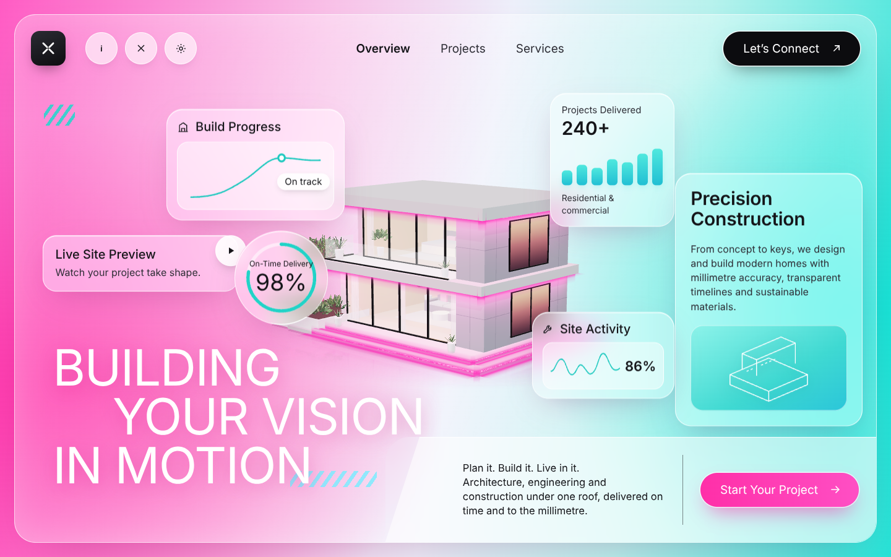
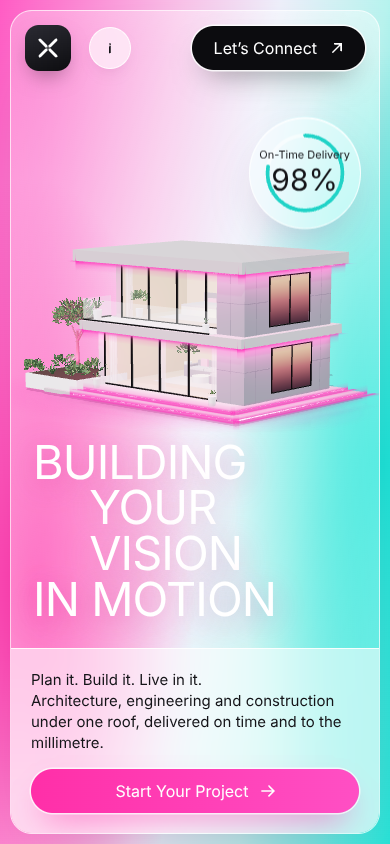

# Pink-lit residence hero

A website hero section with a real-time 3D modern residence: white render, pink
LED strips along the slab soffits and terrace steps, warm-lit furnished
interiors, a glossy floor reflection that fades into a pink-to-cyan gradient,
and frosted-glass UI cards.

| Desktop | Mobile |
| --- | --- |
|  |  |

## Files

| File | What it is |
| --- | --- |
| `index.html` | Hero markup: nav, glass cards, headline, CTA bar. three.js is loaded from jsDelivr through an import map. |
| `hero.css` | Layout, glassmorphism, responsive breakpoints (1280 / 1024 / 720 px), reduced-motion rules |
| `hero.js` | Mounts the 3D scene, shares mouse parallax with the cards, pauses rendering when the hero is off-screen or the tab is hidden |
| `building.js` | The 3D scene module: `mountBuilding(canvas, { reducedMotion })` returns `{ setPointer, pause, resume, dispose }` |

## Run locally

ES modules need a server (opening the file directly won't work):

```bash
cd hero && python3 -m http.server 8080
```

Then open http://localhost:8080.

## Put it on your site

1. Copy the `hero/` folder into your site.
2. Paste the `<section class="hero">…</section>` block, the import map, the font link and the
   `hero.css` / `hero.js` tags into your page.
3. Change the copy, links and card numbers in `index.html`. Brand colours are CSS variables at the
   top of `hero.css`. LED, interior and material colours are in `PALETTE` at the top of `building.js`.

## Motion

- The building slowly sways (±10°, 26 s) and floats (±6 cm, 7 s).
- It eases toward the cursor (±6° turn plus a slight camera orbit); the glass cards shift with their own `data-depth`.
- The LED strips "breathe" (±7% over 5.5 s), and a 2.4 s rise-in plays on load.
- With `prefers-reduced-motion` set, the scene renders a still frame and the cards don't move.

## Performance

The scene is built from simple boxes, with instanced foliage (two draw calls for all leaves). Pixel
ratio is capped at 1.5 on small screens and 2 elsewhere. The reflection renders at about 60% of
screen resolution, the shadow map is 1024 px on small screens, and the render loop stops whenever
the hero isn't visible.
