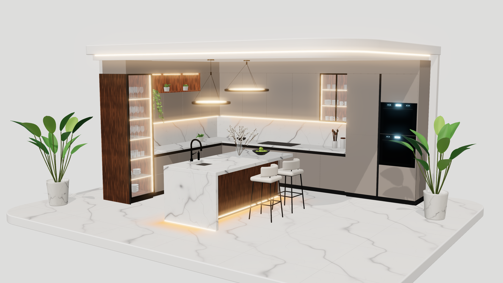

# Kitchen 3D model (website hero)

A detailed, real-time 3D model of the luxury kitchen from the reference render. It is built for the web: about 1 MB, under 100k triangles and 54 draw calls.



## Files to hand off

| File | Use it for |
|---|---|
| `dist/kitchen.glb` | **The website.** Meshopt-compressed and quantised, **986 KB**. Load it with three.js `GLTFLoader` and `MeshoptDecoder`. |
| `dist/kitchen-uncompressed.glb` | Any tool that can't decode Meshopt (Spline, Blender, some online viewers). Same model, no compression extensions, 3.4 MB. |
| `viewer/index.html` | Reference viewer with the lighting, bloom, shadow and camera setup the previews were rendered with. Copy from it. |
| `previews/*.png` | Still renders: hero, side angle, close-up, glass cabinet detail and top view. |

| Metric | Value |
|---|---|
| Triangles | ~96k |
| Meshes / draw calls | 54 (merged by part and material) |
| Materials | 35 PBR (metal/rough) |
| Textures | 5 embedded: marble 1024², floor marble 1024², walnut 512², and 2 small glow gradients |
| Units / axes | metres, +Y up. The kitchen opens toward +X/+Z. |

## What's modelled

- **Stage:** rounded marble-tiled platform on a white plinth, back and side walls, and a floating ceiling canopy with a recessed drop panel and a warm LED cove line.
- **Cabinetry:** handle-less taupe fronts with real 3 mm reveal gaps and black gola channels. Base runs on two walls. Upper cabinets with three walnut-lined lit niches. Tall pantry with a vertical gola, a double built-in oven (black glass, glowing displays, bar handles) and a finished end panel. Bulkheads up to the canopy.
- **Tall glass display cabinet:** black frame, glass door, glass shelves with LED edges, lit walnut interior, wine glasses, tumblers, bowls and plates. The exposed side is clad in walnut slats.
- **Upper glass cabinet:** double glass doors with cups, plates, bowls, tumblers and a small plant.
- **Marble:** procedurally generated Calacatta-style marble (countertops, backsplash, island), with under-cabinet LED strips and a light wash on the backsplash.
- **Island:** marble top with an undermount sink cut-out, a marble waterfall end, a walnut-slat seating side, drawers on the working side, plinth LEDs and a soft glow on the floor. Also a matte-black gooseneck faucet, a soap dispenser, a bowl of green apples, and a glass vase with white flowering branches.
- **Two counter stools:** upholstered seat with a curved backrest, splayed black legs and a footrest.
- **Two ring pendants:** black ring with an LED band and three-wire suspension.
- **Plants:** two large bird-of-paradise style plants in stone pots, a trailing pothos falling from the niche, niche plants and a counter plant.
- **Decor:** cooktop, leaning cutting boards, grinders, utensil crock and canisters.

## Scene structure (node names)

```
Kitchen
├─ Stage            platform, floor, walls, canopy, cove LED
├─ Cabinets         all cabinetry, counters, backsplash, ovens, glass cabinets + contents
├─ Island           island, sink, faucet, fruit bowl, vase + blossoms, floor glow
├─ Stool_A, Stool_B
├─ Pendant_A, Pendant_B      separate groups, so they can sway or animate
├─ Plants
├─ Decor
├─ Lighting_FX      backsplash light-wash decals
├─ LightAnchors     empty nodes to attach real lights to:
│    Anchor_Pendant_A, Anchor_Pendant_B, Anchor_GlassCabinet,
│    Anchor_UnderCabinet_Left, Anchor_UnderCabinet_Back, Anchor_Cove
└─ HeroCamera       the framing used for the hero shot (fov 28°)
```

Meshes are named `<Group>__<Material>`, for example `Island__Marble_Counter`. Each mesh has `userData.castShadow` and `userData.receiveShadow` set: glass, LEDs and glow decals are excluded from shadows.

Useful material names:

- `LED_Warm`: every LED strip and pendant ring. Animate `emissiveIntensity` to switch the lights on or fade them.
- `Cabinet_Taupe`: the cabinet colour. Change `material.color` to offer other finishes.
- `Marble_Counter`, `Marble_Floor`, `Walnut`, `Walnut_Lit`, `Metal_Black`, `Glass_Clear`, `Upholstery_Cream`, `Leaf_*`.

## Loading it (three.js)

```js
import { GLTFLoader } from 'three/addons/loaders/GLTFLoader.js';
import { MeshoptDecoder } from 'three/addons/libs/meshopt_decoder.module.js';

const gltf = await new GLTFLoader().setMeshoptDecoder(MeshoptDecoder).loadAsync('/kitchen.glb');
gltf.scene.traverse((o) => {
  if (o.isMesh) { o.castShadow = o.userData.castShadow; o.receiveShadow = o.userData.receiveShadow; }
});
scene.add(gltf.scene);
const heroCam = gltf.cameras.find((c) => c.name === 'HeroCamera'); // optional starting framing
```

In React Three Fiber, `useGLTF('/kitchen.glb')` from drei decodes Meshopt automatically.

## Recommended look (as in the previews)

- `ACESFilmicToneMapping`, exposure ≈ 0.95, sRGB output.
- An environment map is required for the glossy marble and glass. `RoomEnvironment` through `PMREMGenerator` works, with `scene.environmentIntensity ≈ 0.4`.
- One warm directional key light (intensity ≈ 1.25) with soft PCF shadows, plus a low hemisphere light.
- Bloom with a high threshold, so only the LEDs glow: `UnrealBloomPass(strength 0.55, radius 0.4, threshold 1.6)`.
- Optional cheap point lights (no shadows) on the `Anchor_*` nodes for warm pools of light.
- The model has a light, neutral palette, so it sits well on an off-white page background (`#f4f2ef`). A `ShadowMaterial` plane at `y = -0.161` grounds it.

`viewer/index.html` contains this full setup.

## Rebuilding / editing

The model is fully procedural. `src/kitchen.js` builds every part from code and generates the textures, so dimensions, colours and layout are easy to change.

```bash
npm install
npm run build    # writes dist/kitchen.glb + dist/kitchen-uncompressed.glb
npm run render   # writes previews/*.png (needs Playwright + Chromium)
```
